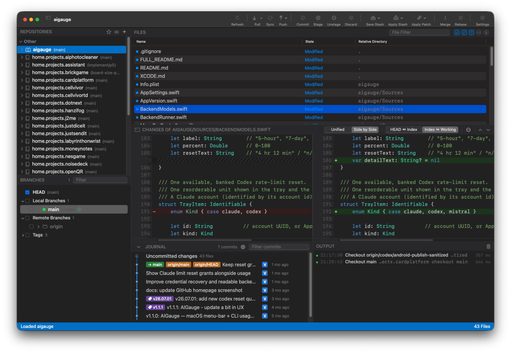

[](https://github.com/vubaone/SmallGit/actions/workflows/ci.yml)
[](LICENSE)
[](#download-and-install)
[](#build--run)

# SmallGit


**SmallGit, Small Potato.**

> Vibe-coded with AI agents. I built it, and you can too. But this one's a small
> potato. Save your AI credits for bigger potatoes.

A free, native, open-source Git client for macOS — a SmartGit alternative built with
Swift and SwiftUI.

**[Website](https://smallgit.vuba.one)** · [Download](https://github.com/vubaone/SmallGit/releases/latest)

> **Early release.** SmallGit runs on real repositories today and is still
> evolving. See the supported features and limitations below, and
> [CHANGELOG.md](CHANGELOG.md).

## Screenshots



Repositories and branches on the left; changed files, side-by-side diff,
commit history and command output in one window.

## Download and install

**[Download SmallGit from GitHub Releases](https://github.com/vubaone/SmallGit/releases/latest)**

Requires **macOS 14 or later** and **Git** installed on your Mac (`git --version`).
The current prebuilt app is for **Apple silicon (`arm64`)**. Intel and universal
downloads are not available yet.

1. Open the release's **Assets** and download `SmallGit-<version>-macos-arm64.zip`.
   The automatically generated "Source code" archives do not contain the app.
2. Unzip it and drag `SmallGit.app` into **Applications**.
3. Open SmallGit. Each release includes a `.sha256` checksum and a `.json` build
   manifest with the source commit, architecture and signing details.

The download is **signed with Developer ID and notarized by Apple**, with the
notarization ticket included in the app. The release pipeline verifies Gatekeeper
acceptance after extracting the final ZIP.
You can also [build from source](#build--run).

## Get started

1. Choose **Open Repository…** (`⌘O`) and select an existing local Git repository.
2. Select a changed file to inspect its diff. Stage the changes you want to
   include with **Stage**; use **Unstage** to remove them from the index.
3. Choose **Commit**, review the staged changes, and write your commit message.
4. Use **Fetch**, **Pull** or **Push** to work with the configured remote.
   For GitHub HTTPS authentication, the sign-in dialog offers
   **Continue with GitHub CLI**. See [GitHub sign-in](docs/authentication.md).

## Why SmallGit

- **Native.** SwiftUI on macOS 14+. No Electron, no JVM.
- **Responsive updates.** Asynchronous Git commands, cached repository data and
  filesystem monitoring keep views up to date.
- **Real conflict tooling.** Four-pane built-in conflict resolver with
  theirs/ours/both and external tool hand-off (Beyond Compare, Kaleidoscope,
  FileMerge).
- **Focused diffs.** Compare staged changes (HEAD ↔ Index) or unstaged changes
  (Index ↔ Working tree), stage / unstage individual lines and ignore whitespace.
- **SmartGit import.** Imports repositories and groups from your existing
  SmartGit configuration.

## Status at a glance

| Area              | Status                                            |
|-------------------|---------------------------------------------------|
| Working tree, staging (file / hunk / line) | ✅ |
| Commit, push, pull, fetch                   | ✅ |
| Branches: create / switch / rename / delete | ✅ |
| Merge with built-in conflict resolver       | ✅ |
| Rebase, including interactive rebase        | ✅ |
| Stash (save / snapshot / pop / apply / drop / list / partial / keep-index) | ✅ |
| Journal / log with commit graph and reflog  | ✅ |
| Whole-history search (--grep / --author / -S / -G) | ✅ |
| Fixup workflow (commit --fixup + autosquash) | ✅ |
| One-click Undo (reflog-based)               | ✅ |
| Worktrees (add / remove / prune / open)     | ✅ |
| Clean Up (remote prune + gc, size report)   | ✅ |
| Blame, tags, remotes                        | ✅ |
| Window position restored per display        | ✅ |
| Terminal panel (⌃⌘T) in place of the diff   | ✅ |
| Cherry-pick UI                              | 🚧 |
| Submodules (states, log of a moved pointer) | ✅ |
| Bisect                                      | 🚧 |
| GPG signing, LFS, PR integration            | 📋 |

### Current limitations

Cherry-pick UI and the bisect wizard are still in progress. Interactive rebase
supports pick, squash, fixup, drop and reordering; reword and edit are not yet
supported. Dedicated GPG signing, Git LFS and pull-request interfaces are planned.

SmallGit is an independent project focused on common SmartGit workflows. It
does not yet cover every SmartGit feature.

## Moving from SmartGit

1. Choose **Sync from SmartGit** on the welcome screen or from the app menu.
   **Re-sync from SmartGit…** is also available in Settings.
2. Review the detected repositories, groups and missing paths, then choose
   **Import**. Existing repositories do not need to be cloned again.

The importer only reads SmartGit's configuration; it does not modify it.
Passwords are not imported. Configure Git credentials or use the GitHub CLI
sign-in when needed.

## Build & run

The Swift package lives in [SmallGit/](SmallGit/). See
[SmallGit/README.md](SmallGit/README.md) for the full build, signing, and
icon-generation instructions. Building requires a compatible **Swift 5.10+**
toolchain, **Git** and **Python 3**. To clone and build the optimized app:

```sh
git clone https://github.com/vubaone/SmallGit.git
cd SmallGit
SmallGit/scripts/build-app.sh --release
```

From the repository root, use the Swift package for development and UI tests:

```sh
cd SmallGit
swift run SmallGit       # dev run
scripts/test-ui.sh       # SwiftUI interactions + renders, no desktop automation
```

Built bundles land in [release/](release/) at the repo root — one place to
look when you want to click the app and review a change.

See [Testing](docs/testing.md) for UI coverage, stable control IDs, artifacts,
and instructions for adding tests. The UI suite uses temporary local Git
repositories and does not launch the app or interact with your desktop.
The full `swift test` suite includes tests that open native windows; run it on
a dedicated test environment. GitHub CI currently runs on demand.

For GitHub HTTPS remotes, the sign-in dialog also offers **Continue with
GitHub CLI**. See [GitHub sign-in](docs/authentication.md) for setup and behavior.

The app version is set in the `AppVersion` constants in
`SmallGit/Sources/SmallGit/Models/AppConfig.swift`. Run `./make_version.sh`
to sync the plist and Xcode metadata; packaging also runs it automatically.
See [Versioning](MAKE_VERSION_GUIDE.MD). The README intentionally avoids
repeating the current version number.

## Release

Run `./release.sh` from a clean, pushed checkout to test, build, package, and
verify a **draft GitHub Release** with the uploaded assets. Use `./release.sh --publish` to
publish after verifying the uploaded assets, or `./release.sh --local` to validate
packaging without uploading. `./release.sh --check` checks release readiness
without building or uploading.
See [Release workflow](docs/releasing.md) for prerequisites, artifacts, and signing.

## Architecture

The landing page source is in `website/`. See [Website development and deployment](docs/website.md)
for Cloudflare Pages setup, local checks and headless browser tests.

A two-page tour: [ARCHITECTURE.md](ARCHITECTURE.md). Deep-dive specs:
[docs/architecture/](docs/architecture/).

## Help and feedback

For bugs and feature requests, [open an issue](https://github.com/vubaone/SmallGit/issues/new/choose).
Include the SmallGit version, macOS version, Mac architecture, and steps to
reproduce the problem. Remove credentials and private repository details from
logs and screenshots. Report security issues privately using [SECURITY.md](SECURITY.md).

## Contributing

We welcome contributions. Please read [CONTRIBUTING.md](CONTRIBUTING.md) and
the [CODE_OF_CONDUCT.md](CODE_OF_CONDUCT.md) before opening a PR.

This project is developed by VUBA (dev@vuba.one) with the help of AI
collaborators (Anthropic Claude, OpenAI Codex). Human and AI contributions
are equally welcome — what matters is that the change is correct, tested,
and motivated.

## Attribution

SmallGit is created by VUBA. If you use this code in your project, a credit and
a link back to [SmallGit](https://github.com/vubaone/SmallGit) would be appreciated.
This is a request, not an additional license requirement. The copyright and
license notice requirements in the [MIT license](LICENSE) still apply.

Suggested credit:

> Includes code from [SmallGit](https://github.com/vubaone/SmallGit) by VUBA.

## License

[MIT](LICENSE) — © 2026 VUBA.

Dependency licenses are listed in [THIRD_PARTY_NOTICES.txt](THIRD_PARTY_NOTICES.txt)
and included in packaged app bundles. See [Security](SECURITY.md) to report a
vulnerability privately.
