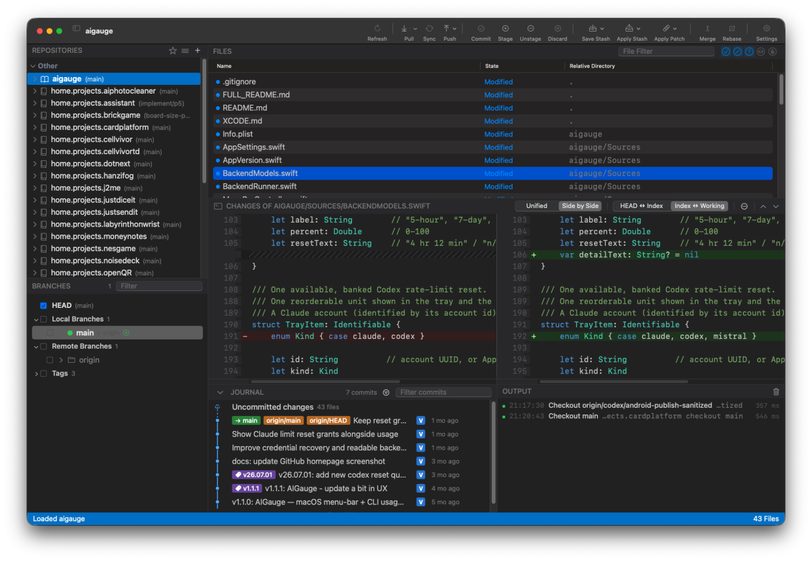

<!-- Bản nháp tiếng Việt để duyệt nội dung. README.md tiếng Anh vẫn là trang giới thiệu chính trên GitHub. -->

[](LICENSE)
[](#yeu-cau)
[](#build-tu-ma-nguon)

# SmallGit


**SmallGit, Small Potato.**

> Vibe-coded with AI agents. I built it, and you can too. But this one's a small
> potato. Save your AI credits for bigger potatoes.

App này được vibe-code cùng các AI agent. Mình làm được, bạn cũng làm được.
Nhưng đây chỉ là một củ khoai nhỏ. Hãy dành credit AI cho những củ khoai lớn hơn.

Ứng dụng Git mã nguồn mở dành riêng cho macOS, được xây dựng bằng Swift và
SwiftUI — một lựa chọn thay thế SmartGit cho công việc hằng ngày.

**[Website](https://smallgit.vuba.one)** · [Tải ứng dụng](https://github.com/vubaone/SmallGit/releases/latest)

SmallGit hướng đến những lập trình viên muốn quản lý nhiều repository, xem diff,
chọn từng phần thay đổi để commit và xử lý lịch sử Git trong một giao diện quen
thuộc trên Mac.

> **Bản phát hành giai đoạn đầu.** SmallGit đã được sử dụng với repository
> thực tế và tiếp tục được phát triển. Xem các tính năng hiện có và giới hạn bên
> dưới, cùng [lịch sử thay đổi](CHANGELOG.md).

## Vì sao SmallGit?

- **Giao diện dành riêng cho Mac.** Xây dựng bằng SwiftUI, hỗ trợ macOS 14 trở lên.
- **Xem và chọn thay đổi chi tiết.** So sánh phần đã stage và chưa stage, xem diff
  cạnh nhau, stage hoặc unstage theo file, khối thay đổi hay từng dòng.
- **Quản lý nhiều repository.** Gom nhóm dự án, thêm nhiều thư mục cùng lúc và
  chuyển nhanh giữa các repository. Repository được thêm sau cùng sẽ được chọn.
- **Làm việc với lịch sử Git.** Đồ thị commit, tìm kiếm lịch sử, interactive
  rebase, fixup, autosquash và trình duyệt reflog.
- **Giải quyết conflict ngay trong app.** Công cụ merge tích hợp với lựa chọn
  ours, theirs hoặc cả hai; có thể kết hợp với công cụ diff/merge bên ngoài.
- **Chuyển từ SmartGit thuận tiện.** Nhập danh sách repository và nhóm từ cấu hình
  SmartGit hiện có trên máy.
- **Terminal và GitHub CLI tích hợp vào quy trình.** Mở terminal ngay trong app;
  dùng tài khoản `gh` để xác thực khi làm việc với GitHub qua HTTPS.

## Tính năng hiện có

| Nhóm | Hỗ trợ |
| --- | --- |
| Repository | Mở, clone, khởi tạo, gom nhóm, thêm nhiều thư mục và nhập từ SmartGit |
| Thay đổi | Trạng thái file, diff, stage/unstage theo file, khối hoặc dòng |
| Đồng bộ | Commit, fetch, pull, push |
| Branch | Tạo, chuyển, đổi tên, xóa và cấu hình upstream |
| Merge | Merge branch và xử lý conflict bằng công cụ tích hợp |
| Rebase | Rebase, interactive rebase với pick/squash/fixup/drop và sắp xếp commit |
| Stash | Lưu, áp dụng, pop, xóa, stash một phần, giữ phần đã stage và lưu snapshot giữ nguyên thay đổi |
| Lịch sử | Đồ thị commit; tìm theo message, tác giả hoặc nội dung thay đổi |
| Khôi phục | Reflog và Undo Last Operation có bước xác nhận |
| Worktree | Thêm, liệt kê, mở, xóa và dọn thông tin worktree không còn hợp lệ |
| Công cụ khác | Blame, tags, remotes, trạng thái submodule, terminal tích hợp |

### Những phần còn đang phát triển

- Giao diện cherry-pick và trình hướng dẫn bisect chưa hoàn thiện.
- Interactive rebase chưa hỗ trợ thao tác reword và edit.
- Giao diện chuyên biệt cho GPG signing, Git LFS và tích hợp pull request còn
  nằm trong kế hoạch.

SmallGit hướng đến việc thay thế các workflow SmartGit thường dùng. Phạm vi
hiện tại được thể hiện trong bảng trên; dự án chưa có đầy đủ mọi tính năng của
SmartGit.

## Chuyển từ SmartGit

1. Ở màn hình chào mừng, chọn **Sync from SmartGit**. Bạn cũng có thể mở lại
   chức năng này từ menu của app hoặc **Re-sync from SmartGit…** trong Settings.
2. SmallGit tìm cấu hình SmartGit trên máy và hiển thị số repository, nhóm cùng
   các đường dẫn không còn tồn tại.
3. Kiểm tra kết quả rồi chọn **Import**. Các repository và nhóm được thêm vào
   danh sách của SmallGit; bạn không cần clone lại repository đã có trên máy.

Quá trình import chỉ đọc cấu hình SmartGit, không sửa cấu hình gốc. Mật khẩu
SmartGit không được nhập; hãy sử dụng cơ chế xác thực Git hoặc đăng nhập GitHub
CLI khi cần. SmallGit là một dự án độc lập.

## Ảnh giao diện



Repository và branch ở bên trái; danh sách file, diff cạnh nhau, lịch sử commit
và kết quả chạy lệnh cùng hiển thị trong một cửa sổ.

## Tải và cài đặt

**[Tải SmallGit từ GitHub Releases](https://github.com/vubaone/SmallGit/releases/latest)**

Bản app đóng gói hiện dành cho **Apple silicon (`arm64`)**. Chưa có bản tải cho
Intel hoặc bản universal.

1. Trong mục **Assets** của release, tải `SmallGit-<version>-macos-arm64.zip`.
   Các gói "Source code" tự sinh chỉ chứa mã nguồn, không chứa app.
2. Giải nén và kéo `SmallGit.app` vào **Applications**.
3. Mở SmallGit. Mỗi release có thêm file `.sha256` để kiểm tra checksum và file
   `.json` ghi commit nguồn, kiến trúc cùng thông tin chữ ký.

Bản tải được **ký Developer ID và Apple notarize**, kèm ticket trong app.
Pipeline kiểm tra Gatekeeper sau khi giải nén ZIP cuối cùng trước khi phát hành.
Bạn cũng có thể [build từ mã nguồn](#build-tu-ma-nguon).

## Bắt đầu sử dụng

1. Chọn **Open Repository…** (`⌘O`) và mở một Git repository có sẵn trên máy.
2. Chọn file đã thay đổi để xem diff. Dùng **Stage** để chọn thay đổi đưa vào
   commit, hoặc **Unstage** để bỏ khỏi index.
3. Chọn **Commit**, kiểm tra phần đã stage và nhập commit message.
4. Dùng **Fetch**, **Pull** hoặc **Push** với remote đã cấu hình. Khi GitHub qua
   HTTPS yêu cầu xác thực, có thể chọn **Continue with GitHub CLI**; xem
   [hướng dẫn đăng nhập](docs/authentication.md).

<a id="yeu-cau"></a>
## Yêu cầu

- macOS 14 trở lên.
- Git có sẵn trên máy.
- Khi build từ mã nguồn: bộ công cụ Swift 5.10 trở lên tương thích với dự án và
  Python 3.
- GitHub CLI (`gh`) là tùy chọn cho đăng nhập GitHub trong app; cần có khi tải
  bản phát hành lên GitHub bằng script của dự án.

<a id="build-tu-ma-nguon"></a>
## Build từ mã nguồn

Clone repository rồi build app tối ưu:

```sh
git clone https://github.com/vubaone/SmallGit.git
cd SmallGit
SmallGit/scripts/build-app.sh --release
```

App được tạo tại `release/SmallGit.app`. Xem [hướng dẫn build và ký
app](SmallGit/README.md) để biết cách cấu hình môi trường và chữ ký.

Từ thư mục gốc repository, để chạy bản phát triển:

```sh
cd SmallGit
swift run SmallGit
```

### Đăng nhập GitHub

Khi một thao tác Git qua HTTPS trên `github.com` yêu cầu xác thực, chọn
**Continue with GitHub CLI**. SmallGit có thể dùng tài khoản `gh` đang đăng nhập
hoặc hướng dẫn đăng nhập qua trình duyệt.

Nếu chưa cài `gh`, nút **Open In-App Terminal** điền sẵn lệnh `brew install gh`.
Bạn nhấn Enter để chạy lệnh. Xem [hướng dẫn xác thực](docs/authentication.md),
bao gồm trường hợp cần quyền bổ sung để push file GitHub Actions workflow.

## Kiểm thử

Chạy suite UI mà không điều khiển chuột, bàn phím hay mở cửa sổ ứng dụng:

```sh
SmallGit/scripts/test-ui.sh
```

Suite tìm control SwiftUI bằng ID, gọi hành động của control rồi kiểm tra trạng
thái giao diện và kết quả Git trong repository tạm. Có báo cáo kết quả và ảnh
render của một số thành phần giao diện.

Chạy bộ kiểm tra dùng cho phát hành, gồm test công cụ release, các regression
test được chọn và suite UI:

```sh
SmallGit/scripts/test-release.sh
```

Bộ `swift test` đầy đủ có các test mở cửa sổ native; nên chạy trên môi trường
test riêng. Xem [tài liệu kiểm thử](docs/testing.md) về phạm vi và cách bổ sung
test.

## Phát hành bằng một lệnh

Từ checkout sạch đã commit và push lên `origin`:

```sh
./release.sh            # Test, build, đóng ZIP và tạo GitHub Release nháp
./release.sh --publish  # Kiểm tra file đã upload rồi công bố bản phát hành mới
./release.sh --local    # Kiểm tra và đóng gói tại máy, không upload
./release.sh --check    # Kiểm tra sẵn sàng, không build hay upload
```

Quy trình tạo app tối ưu, kiểm tra bundle và đính kèm ZIP, SHA-256 cùng thông tin
bản build. File trên GitHub được đối chiếu kích thước và checksum trước khi công
bố. Bản phát hành bắt buộc ký Developer ID, được Apple chấp nhận notarization,
gắn ticket vào app và vượt qua kiểm tra Gatekeeper.
Xem [hướng dẫn phát hành](docs/releasing.md).

Version được quản lý tại `AppVersion` và đồng bộ bằng `./make_version.sh`.
Quy ước đặt version nằm trong [MAKE_VERSION_GUIDE.MD](MAKE_VERSION_GUIDE.MD).

## Hỗ trợ và phản hồi

Để báo lỗi hoặc đề xuất tính năng, hãy
[tạo issue](https://github.com/vubaone/SmallGit/issues/new/choose), ghi rõ version
SmallGit, version macOS, kiến trúc Mac và các bước tái hiện. Loại bỏ thông tin
đăng nhập và dữ liệu repository riêng tư khỏi log, ảnh minh họa. Với lỗ hổng bảo
mật, dùng kênh báo cáo riêng trong [SECURITY.md](SECURITY.md).

## Đóng góp

Mã nguồn landing page nằm trong `website/`. Xem
[hướng dẫn website](docs/website.md) để cấu hình Cloudflare Pages, kiểm tra và
chạy test trình duyệt headless.

Báo lỗi, đề xuất tính năng, cải thiện tài liệu và pull request đều được chào đón.
Hãy đọc [hướng dẫn đóng góp](CONTRIBUTING.md) và
[quy tắc ứng xử](CODE_OF_CONDUCT.md) trước khi bắt đầu.

Để tìm hiểu code, xem [tổng quan kiến trúc](ARCHITECTURE.md) và
[tài liệu thiết kế](docs/architecture/).

SmallGit được phát triển bởi **VUBA** (dev@vuba.one), với sự hỗ trợ của các công
cụ AI như Anthropic Claude và OpenAI Codex. Mọi đóng góp đều cần được kiểm tra,
kiểm thử phù hợp và có mục đích rõ ràng.

## Ghi nhận tác giả

SmallGit được tạo bởi VUBA. Nếu sử dụng mã nguồn này trong dự án của bạn, mình
rất mong bạn ghi credit và dẫn link về
[SmallGit](https://github.com/vubaone/SmallGit). Đây là lời đề nghị, không phải
điều kiện cấp phép bổ sung. Các yêu cầu giữ thông báo bản quyền và cấp phép
trong [giấy phép MIT](LICENSE) vẫn áp dụng.

Bạn có thể dùng dòng credit sau:

> Includes code from [SmallGit](https://github.com/vubaone/SmallGit) by VUBA.

## Giấy phép và bảo mật

[MIT](LICENSE) — © 2026 VUBA.

Thông tin giấy phép của các dependency nằm trong
[THIRD_PARTY_NOTICES.txt](THIRD_PARTY_NOTICES.txt) và được kèm trong app đóng gói.
Để báo cáo lỗ hổng riêng tư, xem [chính sách bảo mật](SECURITY.md).
